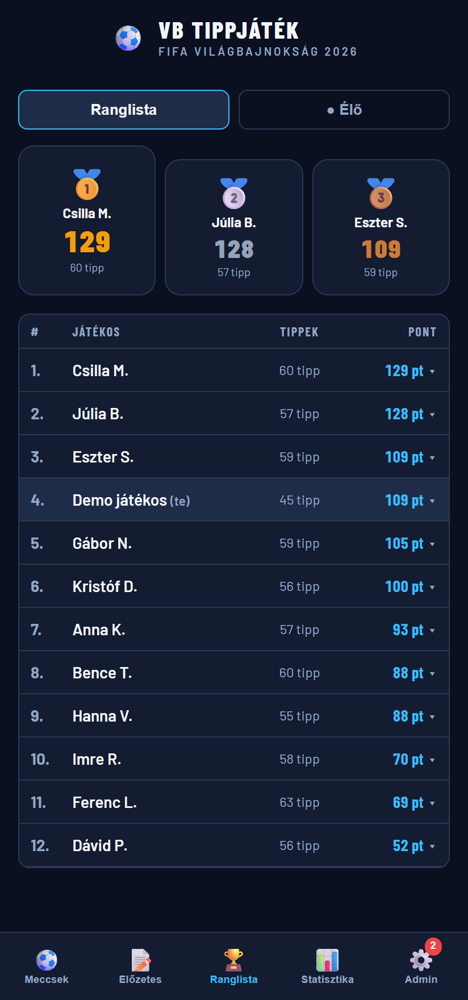
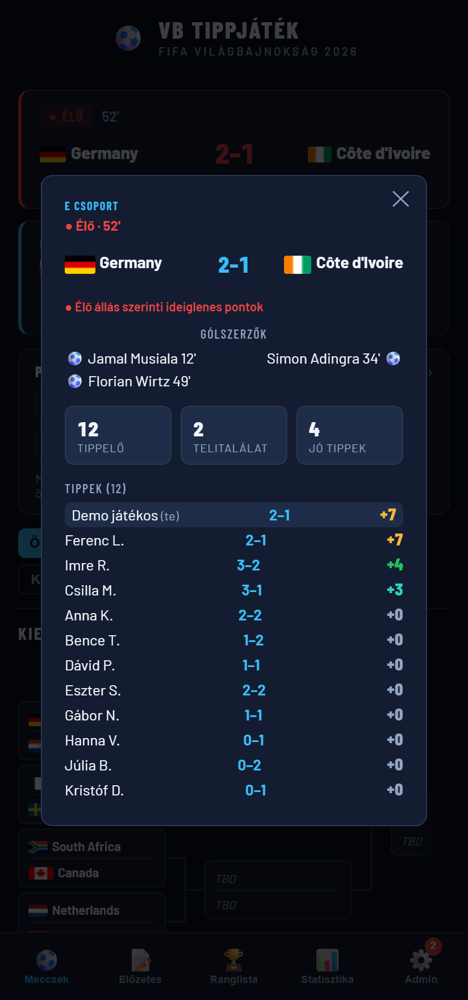
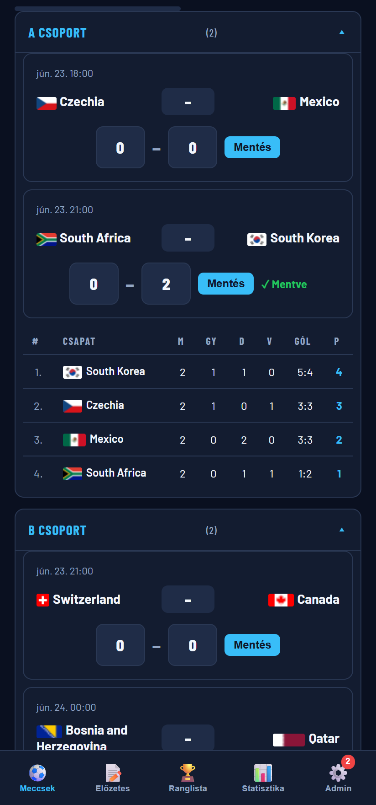
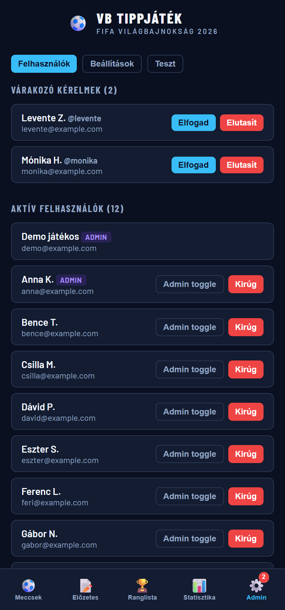

# World Cup 2026 Prediction Game

[](https://github.com/bummafejbe/VB-tippjatek/actions/workflows/test.yml)

A prediction game web app I built for a group of friends for the 2026 FIFA World Cup: everyone tips the score of every match, and points and the leaderboard update live as games are played.

About 20 people used it throughout the tournament (June–July 2026). The UI is in Hungarian.

## Features

- **Registration with admin approval.** New accounts start as `pending` and can't see any game data until an admin approves them. Admins can also ban users and grant the admin role to others.
- **Match tipping.** You can tip every group and knockout match until kickoff. After kickoff your tip locks and everyone's tips for that match become visible. Before kickoff you only see your own.
- **Scoring system.** Each match is worth up to 7 points, and only the highest category you reach counts: exact score 7, correct result and goal difference 4, correct result plus one team's goals 3, correct result only 2.
- **90-minute rule for knockout games.** Knockout tips are scored on the score after 90 minutes, not the score after extra time or penalties. Extra-time and penalty results are still shown, but they don't count toward points (see *Challenges* below).
- **Live scores and provisional points.** Live matches are polled every 10 seconds, with the score, match minute and goalscorers. The leaderboard has a "Live" view that shows provisional points based on the current score.
- **Leaderboard and stats.** The leaderboard has a podium and a points breakdown for each player, and you can open any player's full tip history. A statistics tab shows the best tipper, the most exact scores, the highest-scoring match and similar figures. Each match also has its own stats: how many people tipped it, how many got it exactly right and how many got the result right.
- **Group tables and knockout bracket.** Group standings are calculated from results. The knockout bracket fills in automatically as teams advance, including shoot-out winners.
- **Pre-tournament tips.** Before the opening match, players pick the top scorer (10 points) and the tournament winner (15 points). These tips lock at a deadline the admin sets, and after that everyone's picks are shown on two public boards.
- **Admin panel.** It has three parts: user management, settings (API key, pre-tournament deadline and the status of the last server sync, with a link to trigger a sync manually) and a **scoring test panel**. In the test panel an admin can enter made-up results and tips for sample group and knockout matches and check the points the real scoring function gives. Its data is stored in the database, so all admins see the same test data.
- **Quality-of-life features.** Next-match countdown, match filters (open / played / not yet tipped), a mobile bottom navigation bar, team flags, and an automatic page reload when a new version is deployed.

## Tech stack and architecture

| Layer | What's used |
|---|---|
| Frontend | A single `index.html` (HTML + CSS + vanilla JS) with no framework and no build step |
| Auth | Firebase Authentication (email + password) |
| Database | Firebase Realtime Database, accessed through its REST API |
| Access control | Realtime Database security rules (`database.rules.json`) |
| Hosting | Firebase Hosting |
| CI/CD | GitHub Actions |
| Data sources | [football-data.org](https://www.football-data.org/) (fixtures, results) and ESPN's public scoreboard/summary endpoints (live scores, knockout details) |

```
 football-data.org ─┐                       ┌──────────────────────────┐
                    ├─► sync-results.js ───►│ Firebase Realtime DB     │◄── index.html (browser)
 ESPN scoreboard ───┘   (GitHub Actions     │ users / tips / matches   │       │
                         cron)              │ guarded by security rules│       └─► ESPN (live overlay,
                                            └──────────────────────────┘           polled every 10 s)
```

- **`.github/workflows/deploy.yml`.** Every push to `main` deploys hosting and the database rules together with `firebase-tools`.
- **`.github/workflows/sync-results.yml`.** A scheduled job (and a manual trigger) that runs `.github/scripts/sync-results.js`. The script is plain Node.js with no npm dependencies. It:
  - seeds the fixture list,
  - fills in knockout team names once they're known,
  - writes final results and corrects them during a 60-minute window after the final whistle (for goals overturned by VAR),
  - calculates the 90-minute score of knockout matches from the ESPN per-period data,
  - records the winner that advances,
  - writes the live score.
- **Why the sync runs on a server:** football-data.org doesn't allow browser (CORS) requests from the production domain, so the API is called from GitHub Actions.
- **Security rules.** All game data can be read only by approved (`active`) users or admins. Email addresses are kept in a separate `userPrivate` branch that only the user and admins can read. Tips are validated (shape, value range) and can't be changed once the match has a result. Users can't approve themselves.
- **Tests.** The sync logic is built from pure decision functions (`planResultUpdate`, `planKnockoutResult`, `planNameUpdate`, `pickFinalResult`, …) covered by 56 dependency-free unit tests: `node .github/scripts/sync-results.test.js`. The `test.yml` workflow runs them on every push and pull request, along with a syntax check of the app's inline script and validation of the JSON configs.

## Challenges and what I learned

**1. Knockout matches never got live data: a root-cause analysis.**
*Symptom:* during the knockout rounds, the live scores of knockout games were wrong or frozen, and a goal overturned by VAR stayed on the board.
*Investigation:* every link between our data and ESPN (live overlay, live score, final result) matched games by team name. Knockout fixtures are created with `TBD` placeholder names, and the sync had never updated them. As a result, ESPN never matched any knockout game, and the app quietly fell back to a stale score from the other API.
*Fix:* a new `planNameUpdate` step fills in the real team names before any ESPN matching runs. The browser overlay now also uses the team names from the bracket logic, so it no longer depends on the cron job. Regression tests cover partial data (only one team known) and the case where the API doesn't know the names yet.
*Lesson:* the visible bug (a wrong score) was two steps away from its cause (a missing data update). Following the data through the pipeline found the cause faster than patching the symptom.

**2. Scoring on the 90-minute score.** The rule says knockout tips count on the score after 90 minutes. The first version stored the API's `fullTime` score, which includes extra time and penalties. The next fix used football-data's `regularTime`, which turned out to be unreliable: it was sometimes missing and the code fell back to the score after extra time. One real match was stored as 3–2 instead of 1–1. The final fix calculates the 90-minute score from ESPN's per-half data (1st + 2nd half). It also repairs results that were already stored wrongly, whenever the match was played. Unit tests use real matches as fixtures (after extra time, after penalties, home and away swapped, missing data).

**3. Correcting results after VAR.** Results used to be written once and never checked again. So a goal scored near the final whistle and then overturned by VAR stayed in the database (5–0 instead of 4–0) and gave players the wrong points. The fix is a pure `planResultUpdate` function that re-checks each result against the source for 60 minutes after it's first written and never overwrites a result an admin entered by hand. Every branch, including the exact 5–0 → 4–0 case, has a unit test.

Smaller issues along the way:
- **A deploy that failed even though it worked.** The hosting release sometimes reported a failure while actually succeeding (a retry race). The workflow now treats that one specific error message as success and still fails on any other error.
- **Missing values that broke checks.** Firebase's REST API drops `null` fields, so a missing result comes back as `undefined` and strict `!== null` checks misfire. Loose `!= null` checks fix this.

## Known limitations

- Tip locking at kickoff is enforced by the UI. The database rules only lock a tip once the match has a result, because the rules can't compare dates stored as ISO strings.
- Before kickoff the UI hides other players' tips, but an approved user could still read them directly from the database.

## Screenshots

To protect the real players' privacy, the screenshots show the real app running on **fictional demo data**: invented players, `example.com` emails and a mocked mid-group-stage moment with one live match.

| Leaderboard | Live match |
|---|---|
|  |  |

| Tipping | Admin panel |
|---|---|
|  |  |

## Running it yourself

1. Create a Firebase project with Email/Password auth and a Realtime Database, and put your web config into `FIREBASE_CONFIG` in `index.html`.
2. Deploy the rules and hosting with `firebase deploy`.
3. To make yourself the first admin, set `/admins/{your-uid}: true` in the Firebase console.
4. For the sync, add the `FIREBASE_SERVICE_ACCOUNT`, `FIREBASE_DB_SECRET` and `FOOTBALL_DATA_API_KEY` GitHub secrets.

---

> **Note:** The tournament is over, so the live features (score sync, live overlay) are no longer running. The screenshots were made afterwards with demo data (see above).
